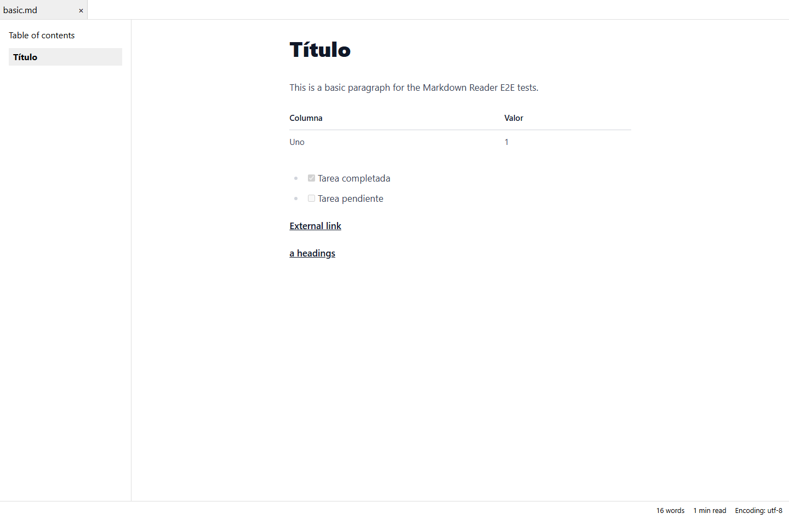

# Markdown Reader



Markdown Reader is a secure, cross-platform desktop app for reading Markdown files. It is built with Tauri 2, Rust, Svelte 5, TypeScript, and Vite.

## Phase 1 features

- Safe Markdown rendering with GitHub Flavored Markdown, alerts, heading links, and Shiki syntax highlighting.
- Inline and display math rendered locally with KaTeX (`$...$` and `$$` on separate lines).
- Mermaid diagrams rendered on demand with strict SVG sanitization and light/dark themes.
- Multiple tabs, drag-and-drop, recent files, pinned files, and session/scroll restoration.
- Table of contents, word count, estimated reading time, and encoding information.
- Relative local images, optional blocking of remote images, and automatic file reload while preserving the reading position.
- Find in document, English and Spanish UI, keyboard shortcuts, native menus, and configurable theme and typography.
- Windows file association, single-instance handling, and command-line file opening.

## Download

Installers are published as draft releases on the [GitHub Releases](https://github.com/abelrgr/markdown-reader/releases) page. The current development version is `2.0.0-beta.1`.

## Development

Requirements: Node.js 24 LTS with npm, Rust stable 1.85 or newer, and the [Tauri system prerequisites](https://v2.tauri.app/start/prerequisites/) for your operating system.

```sh
npm ci
npm run tauri dev
npm test
npm run e2e
```

Other checks: `npm run check`, `npm run build`, `cargo test --manifest-path src-tauri/Cargo.toml`, and `cargo clippy --manifest-path src-tauri/Cargo.toml -- -D warnings`.

## Project structure

- `src/` — Svelte UI, native API boundary, Markdown pipeline, state, and DOM utilities.
- `src-tauri/` — Rust backend and Tauri configuration.
- `tests/e2e/` — Playwright tests and Markdown fixtures.
- `docs/` — refactor specification, plans, and QA checklist.
- `examples/` — sample Markdown documents for testing reader features.
- `legacy/` — archived NeutralinoJS v1 application, retained for reference.

## License

MIT. See [LICENSE](LICENSE).
