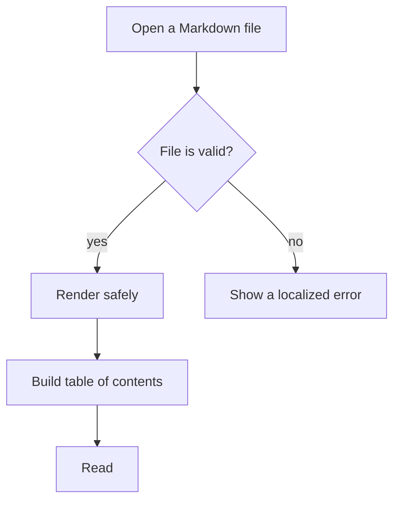
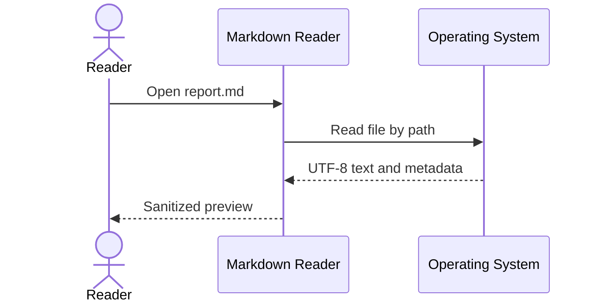
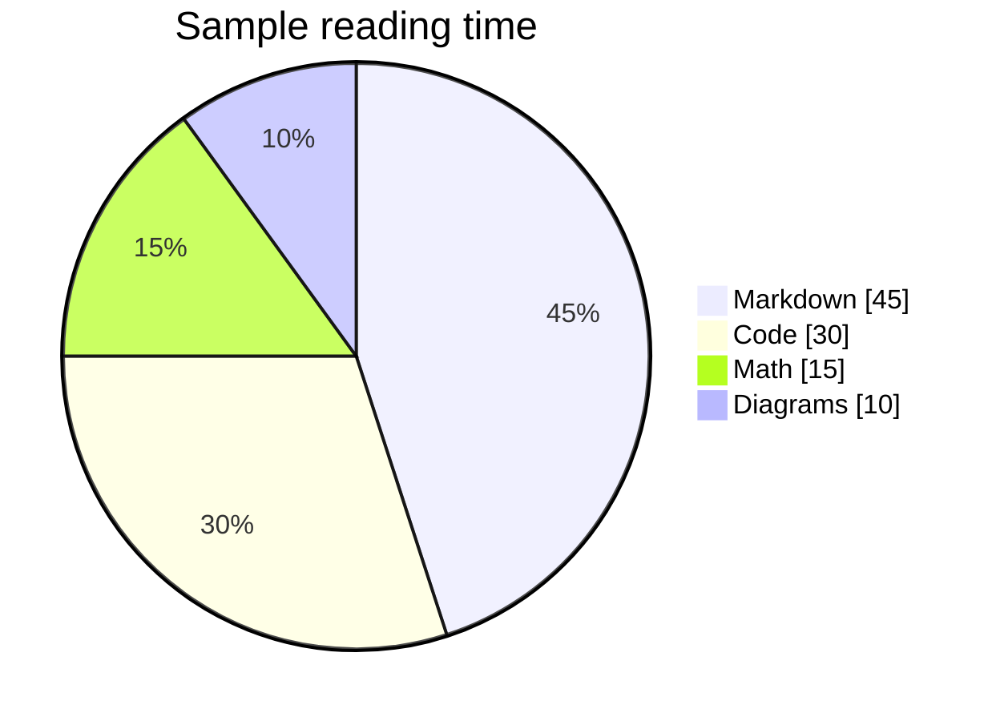
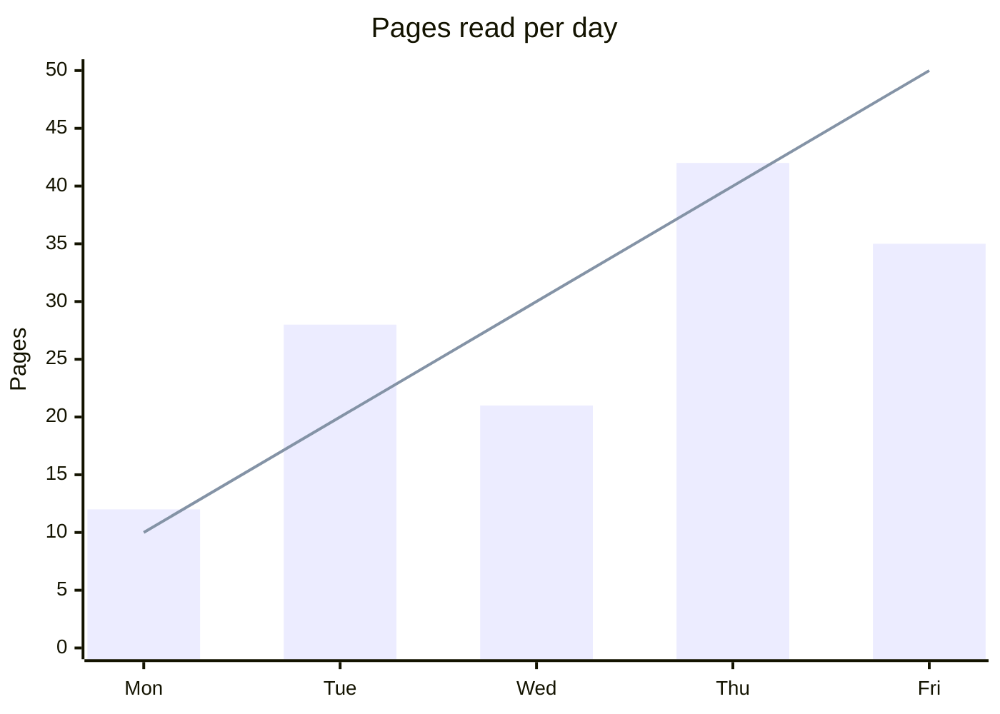

# Diagrams and Charts

## Flowchart



## Sequence diagram



## Pie chart



## XY chart



## Invalid diagram fallback

This intentionally malformed block checks that one diagram error does not break the rest of the document:

```mermaid
this is not a valid diagram !!!
```

## Ordinary code fence

This should remain a regular code block, not a diagram:

```text
diagram source is only special when the language is mermaid
```

Continue to [the code samples](04-code-and-data.md#typescript).
